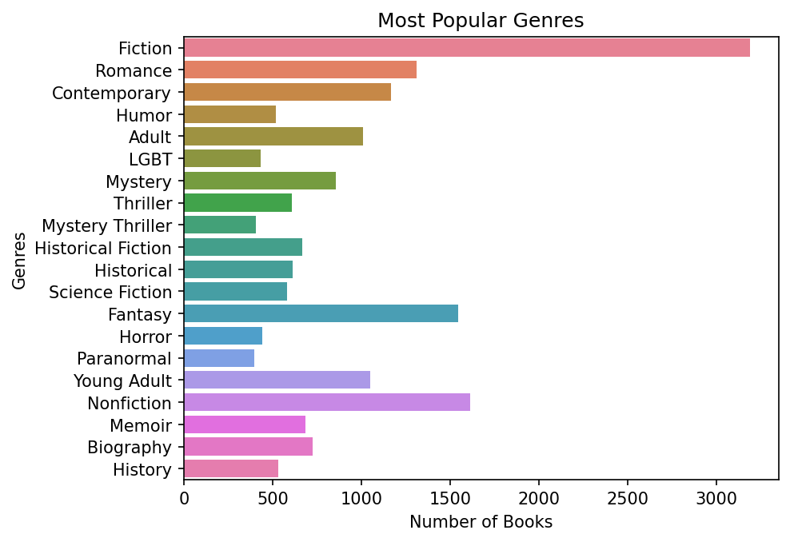

# 📚 What the Goodreads Choice Awards Reveal About Reader Preferences and Publishing

An exploratory data analysis of **Goodreads Choice Awards finalists from 2011–2024**, looking at which genres and book lengths readers favour, how those trends shift over time, and whether publishers seem to follow them.

## Questions Explored

- Which genres get nominated most, and which earn the highest ratings?
- How has the popularity of genres like Fantasy changed from year to year?
- Do publishers release more books in a genre after it trends on Goodreads?
- Is there a "sweet spot" for book length among award finalists?

## 📊 Key Findings

- **Fiction dominates**: Fiction is by far the most nominated genre. Nonfiction comes second, but well behind it, and most of the top 20 genres (out of 456 total) fall under fiction.

 

- **Fantasy cycles around**: Fantasy, the most popular fiction genre, peaked in 2011–2012 and has never reached that level of attention again. Nominations seem to rise roughly every four years.
- **Publishers follow the trends**: Fantasy releases tend to go up after each rise in Fantasy's popularity, which suggests publishers may use Goodreads trends when planning releases.
- **Popular ≠ highest rated**: History is one of the least nominated of the top genres but has the highest average ratings, likely because its smaller, more specialized audience is more engaged. Most other genres cluster between 3.75 and 4.25 stars.

 

- **300–400 pages are the most common book lengths**: Finalists consistently fall in the 300–400 page range, across every award year.

## Tech Stack

- **Python**: pandas, NumPy
- **Visualization**: Seaborn, Matplotlib
- **Parsing**: `ast` (to safely turn string-encoded genre lists into real lists)
- **Environment**: Jupyter Notebook

## Data Cleaning

- Dropped columns not used in the analysis (price, votes, star breakdowns, review counts, author stats)
- Removed rows with missing values
- Parsed each book's genre list, which was stored inconsistently as either real lists or strings, and **exploded** it so each genre gets its own row, since many books span several genres
- Excluded "Audiobook" from genres, because the analysis doesn't look at book format

##Data

[Goodreads Choice Awards 2011–2024 Books](https://www.kaggle.com/datasets/krisbruurs/goodreads-choice-awards-2011-2024-books/data) on Kaggle, which covers every finalist with its genres, rating, rating count, page count, publication year, and award year.

Download `final_books_data_2011_2024.csv` and put it in the same folder as the notebook.

## Getting Started

```bash
git clone https://github.com/YOUR-USERNAME/goodreads-analysis.git
cd goodreads-analysis
pip install -r requirements.txt
jupyter notebook
```

Then open the notebook and run all cells.
